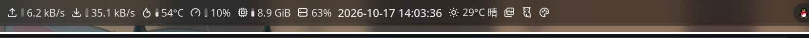
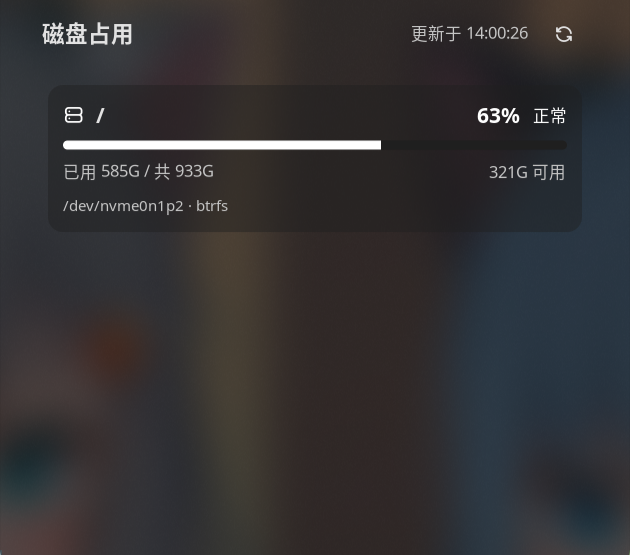

# ylxc/disk —— 磁盘占用（状态栏组件 + 详情面板）

在状态栏上显示磁盘占用：默认是挂载点的占用百分比，鼠标悬停能看到每块磁盘的明细，左键点开一个**每个文件系统一张卡片**的详情面板。

数据全部来自宿主自己的 `statvfs` 快照（`noctalia.diskMounts` / `noctalia.diskStats`）：插件不读 `/proc`、不落盘、没有常驻进程、没有外部依赖。

```
bar.luau    ─┐
             ├─▶ lib/disk.luau ──▶ noctalia.diskMounts() / noctalia.diskStats(path)
panel.luau  ─┘        （取值、格式化、阈值分级）
```

## 效果





## 安装与启用

插件目录：`~/.local/share/noctalia/plugins/ylxc-disk/`

1. **设置 → 插件** → 找到 **Disk Usage**（作者 ylxc）并启用。
2. 把它加进栏里：**设置 → 栏** → 添加组件 → 选 `ylxc` / `disk` / `usage`。
   也可以手写配置（`~/.local/state/noctalia/settings.toml`）：

   ```toml
   [bar.default]
   center = ["ram", "disk", "clock"]   # 位置随你，名字自取

   [widget.disk]
   type = "ylxc/disk:usage"
   ```

   改完执行 `noctalia msg config-reload` 生效。

离线自检（不启动 shell）：

```bash
noctalia plugins lint ~/.local/share/noctalia/plugins/ylxc-disk
```

## 配置

### 插件级（设置 → 插件 → Disk Usage 的齿轮；栏组件与面板共用）

| 键 | 类型 | 默认 | 说明 |
| --- | --- | --- | --- |
| `warn_percent` | int（50–99） | `80` | 占用率超过它算「偏高」 |
| `crit_percent` | int（51–100） | `90` | 占用率超过它算「告急」 |
| `refresh_seconds` | int（2–600） | `30` | 刷新间隔；栏组件与面板共用一个节奏 |
| `tooltip_mounts` | bool | `true` | 悬停时是否列出所有磁盘 |
| `tooltip_max` | int（1–16） | `6` | 悬停时最多列几个（仅在上一条打开时显示） |

### 组件级（栏组件自己的设置）

| 键 | 类型 | 默认 | 说明 |
| --- | --- | --- | --- |
| `mount` | string | 空 | 显示哪一块磁盘：留空 = 占用率最高的那个；也可以填挂载点（`/`）、块设备（`/dev/nvme0n1p2`）或任意目录（自动匹配它所在的文件系统） |
| `display` | select | `percent` | 栏上显示什么，见下表 |
| `glyph` | glyph | `server` | 图标（Tabler 图标名） |
| `show_glyph` | bool | `true` | 是否显示图标 |
| `glyph_color` | select | `level` | 图标颜色：`level` 跟随阈值变色、`theme` 用组件自己的配色、其余为固定颜色 |

`display` 的取值：

| 值 | 栏上长这样 | 说明 |
| --- | --- | --- |
| `percent` | `63%` | 默认 |
| `used` | `585G/933G` | 已用 / 总量 |
| `free` | `321G 可用` | 剩余可用空间 |
| `free_percent` | `34% 可用` | 剩余百分比 |
| `bar` | ▓▓▓▓░░ `63%` | 迷你进度条 + 百分比；竖向栏会自动排成上下 |

文字颜色同样跟随阈值：正常用主题主色（`on_surface`，也就是组件自己的配色），偏高转 `tertiary`，告急转 `error`，所以浅色/深色主题都好看。

## 交互

| 动作 | 默认行为 |
| --- | --- |
| 左键 | 打开详情面板 `ylxc/disk:panel` |
| 右键 | 立刻重读一次 `statvfs` 并重画（不用等刷新周期） |
| 中键 | 打开这个组件的设置（宿主默认绑定） |
| 滚轮 | 在所有磁盘之间循环切换显示（只影响当前显示，不改设置，插件重载后回到设置里的那块） |

这几个绑定都写在 `plugin.toml` 的 `[widget.actions]` 里，可以在**设置 → 栏 → 组件手势**中改绑或改成 `none`。

详情面板：每个物理块设备文件系统一张卡片，含占用百分比、阈值状态、进度条、`已用 / 共` 与 `设备 · 文件系统`；右上角的刷新按钮立即取数。

## 工作原理与细节

- **数据源**：`noctalia.diskMounts()` 列出物理块设备文件系统（按设备去重、按挂载路径排序），`noctalia.diskStats(path)` 返回该挂载点的一次采样 —— `usagePercent` / `totalBytes` / `freeBytes` / `availableBytes`。两者都接受绝对路径或 `~/` 路径，返回 `nil` 表示路径不可用。
- **占用率**：用 `usagePercent`（与 `df` 的 `Use%` 一致，即 `(total - free) / total`）。`freeBytes` 与 `availableBytes` 不同，后者已扣掉 root 预留 —— 「剩余可用」显示的是 `availableBytes`。
- **开销**：每次刷新只调用一次 `diskMounts` 与一次 `diskStats`，结果缓存在内存里由栏组件和面板共用；没有磁盘 I/O，刷新间隔最小 2 秒。
- **配色**：阈值分级 `ok` / `warn` / `crit` → 主题角色 `primary` / `tertiary` / `error`。
- **IPC**：`noctalia msg plugin ylxc/disk:usage focused refresh`、`next` / `prev`（切换磁盘）、`panel`（开合面板）。

## 文件结构

```
ylxc-disk/
├── plugin.toml          清单：设置 schema、栏组件、详情面板
├── bar.luau             栏组件（命令式渲染；bar 模式用 ui.* 声明式树）
├── panel.luau           详情面板
├── lib/disk.luau        共用的取值、格式化、阈值分级
├── translations/
│   ├── en.json
│   └── zh-Hans.json
└── docs/                截图
```

## 限制

- 只列**物理块设备**上的文件系统（宿主 `diskMounts` 的口径），`tmpfs`、`overlay`、网络挂载等不会出现；要看某个目录的配额，可以把 `mount` 填成该目录来近似。
- 面板尺寸固定 `420×400`；面板的实际摆放位置（贴栏 or 居中）由宿主的插件偏好 `panel_placement` 决定，可以在插件设置里改。

## 许可

MIT
